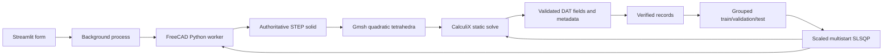

# Architecture

The public Python package is `src/conrod`. Units are mm, N, MPa and kg for reporting.
The solver static deck has no inertial mass term; density is used for CAD mass only.

- `schemas`: typed, immutable geometry/material/load/mesh/constraint inputs.
- `geometry`: the sole solid-building implementation. Only executed inside FreeCAD Python.
- `analytical`: independently testable shank estimates and Euler rejection screen.
- `fea`: explicit modes, command diagnostics, geometric bore recognition, mesh transfer, deck construction, result parsing.
- `dataset`: seeded LHS, rejection rather than clipping, resumable cases, separate failures.
- `surrogate`: trusted local serialization, grouped splits, baseline/model comparison and residual margin.
- `optimizer`: persistent isolated CAD mass process, full-precision SLSQP, bounded final verification.
- `visualization`: neutral CAD tessellation and real element stress sample cloud.

The main UI never imports FreeCAD. FreeCAD 1.1.4's bundled Python 3.11 imports its own binary modules; the application uses Python 3.13. JSON separates the runtimes. This was tested rather than injecting FreeCAD binaries into incompatible system Python.

The direct CalculiX deck avoids GUI-dependent FreeCAD FEM writer state. Preflight imports `ObjectsFem`, `femmesh.gmshtools` and `femtools.ccxtools`; FreeCAD owns geometry, Gmsh meshes that exact exported STEP, and CalculiX owns all FEA response values. This is a deliberate module-boundary adjustment permitted by the implementation brief.

Every solver case keeps request, CAD metadata, BREP, STEP, STL, FCStd, mesh, INP, DAT, FRD, logs, fields and result metadata in a unique directory. Cache keys do not round geometry. No optimization or model training occurs when an ordinary input control changes.

External processes have timeouts. The optimizer permits at most three candidate verifications (two cases each), plus baseline solves when a candidate passes. Solver errors remain failures; no analytical fallback exists.
