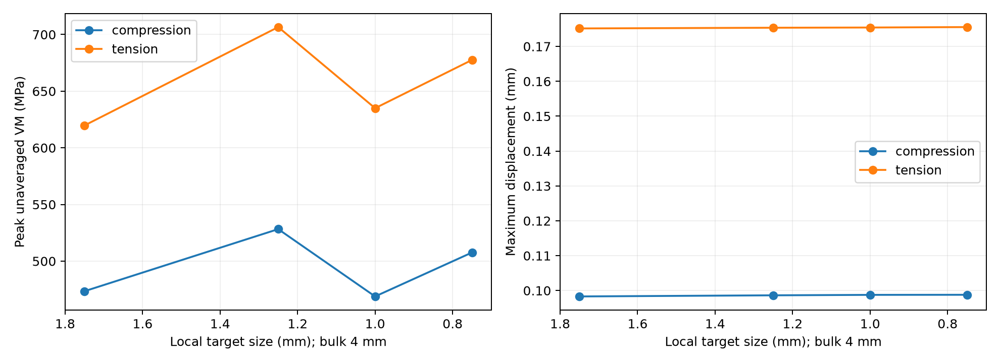

# Mesh convergence — Phase 2

Status from executed focused studies: {"compression": "NOT CONVERGED", "tension": "NOT CONVERGED"}.

Global4,2.5,1.75,1.25 mm meshes were generated. Finer global cases exceeded the250000-node solve budget; their failed records and meshes are retained. Global1 mm was not attempted after that resource limit. A separate focused series uses4 mm bulk and local1.75,1.25,1.0,0.75 mm targets around junction/pocket-corner neighborhoods. These are distinct refinement families, not equivalent global mesh sizes.

## Compression

- Local 1.75 mm: 25631 nodes / 14555 elements; peak 473.459 MPa; U 0.098311 mm; FoS 1.4996; 10.3 s; hotspot [30.922464652811673, 12.46056846185764, 0.753794853372269] mm, element 19000, IP 4.
- Local 1.25 mm: 32260 nodes / 18902 elements; peak 528.245 MPa; U 0.098635 mm; FoS 1.3441; 16.2 s; hotspot [30.924601543081135, -12.514179590384929, 19.592709363636192] mm, element 25523, IP 3.
- Local 1.0 mm: 40062 nodes / 24129 elements; peak 468.839 MPa; U 0.098762 mm; FoS 1.5144; 20.8 s; hotspot [30.773318980930508, 12.460716918819564, 1.3937735254471593] mm, element 22566, IP 1.
- Local 0.75 mm: 57016 nodes / 35495 elements; peak 507.604 MPa; U 0.098786 mm; FoS 1.3987; 41.7 s; hotspot [30.73301213665421, -12.518544357521312, 2.777020368912087] mm, element 38777, IP 1.

## Tension

- Local 1.75 mm: 25697 nodes / 14594 elements; peak 619.735 MPa; U 0.175162 mm; FoS 1.1457; 11.3 s; hotspot [30.478054454499862, -12.695652381461478, 0.513899160073195] mm, element 20825, IP 3.
- Local 1.25 mm: 32304 nodes / 18925 elements; peak 706.564 MPa; U 0.175366 mm; FoS 1.0049; 16.4 s; hotspot [30.515215705013137, -12.77992175351419, 2.4115824111477764] mm, element 25531, IP 1.
- Local 1.0 mm: 40051 nodes / 24122 elements; peak 634.977 MPa; U 0.175428 mm; FoS 1.1182; 20.4 s; hotspot [30.498081652697262, -12.706210223602035, 21.668185478884002] mm, element 31297, IP 1.
- Local 0.75 mm: 56671 nodes / 35242 elements; peak 677.558 MPa; U 0.175552 mm; FoS 1.0479; 34.5 s; hotspot [30.45740555241589, 12.718365505880689, 18.840576684843] mm, element 25926, IP 3.

A repeated nominal 4 mm bearing compression mesh gave 477.73 MPa in the pilot versus 462.27 MPa in the comparison. Gmsh multithreaded mesh variability and stress sampling therefore matter; preserved decks are the reproducibility reference, not a bitwise-regeneration promise. Displacement stabilizes, but peak stress varies above 5% in successive refinements. Hotspots remain at the big-end/shank transition, not the gauge nodes. This is not enough to declare a mathematical singularity: finite-radius concentrations, geometric resolution and discrete bearing-load quadrature remain competing explanations. Local2 mm IP means are descriptive, unweighted and centered on the moving peak; they are not substituted for the maximum to make a design pass. No mechanically qualified design is claimed. Further investigation needs controlled surface quadrature, a deterministic mesh study and additional resolution through the fillets.

Full coordinates, quality and runtimes: `evidence/phase2/experiments.csv` and compact result JSON. Gauss coordinates use quadratic C3D10 shape functions with CalculiX gauss3d5 ordering, verified on an affine tetrahedron. Historical Phase 1 hotspots are independently reconstructed in `historical-hotspots-report.json`; original raw records remain unchanged.
