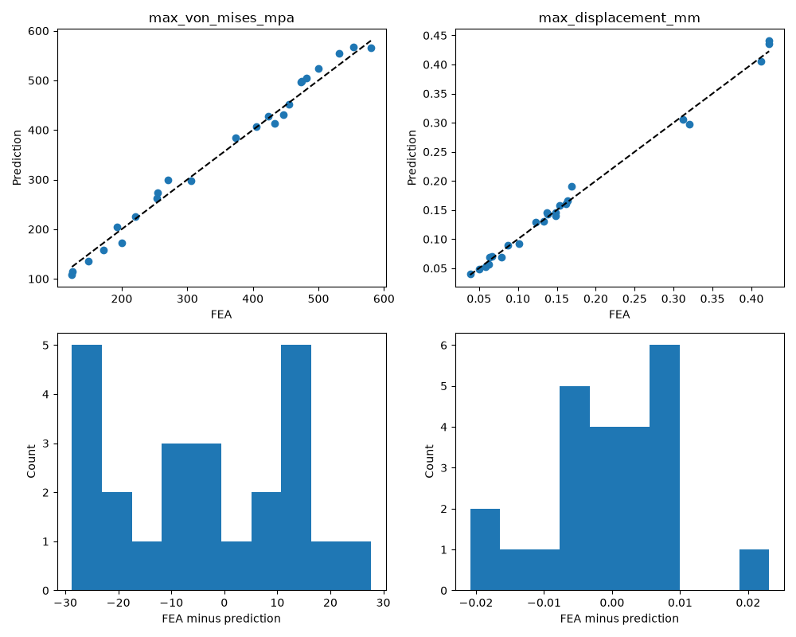

# Machine-learning evaluation

## Provenance and scope
The active model uses 120 actual CalculiX analyses from 60 batch-LHS geometries (seed 44), each solved in compression and tension at a 5 mm maximum mesh size. Generation took 349.43 s, with zero failed analyses. Packaging is fixed to 145/50/24 mm; no packaging generalization is claimed.

The pilot (24 analyses) and initial unstratified expansion (120 analyses) are retained as separately labelled experiments and are **not** part of the active model. The one-point-at-a-time sampling issue was found and corrected before final model training. Original 300-row analytical-response data remains separate and unused.

Dataset SHA256: `ef2f8d2769ca7e8205429e5ef581dc4e48a5fa480021f85a08d8803c05c69fe1`.

## Split and selection
Geometry groups include all load/material variants and any geometries within 1% of each dimensional span, using transitive neighbour grouping. Train/validation/test counts are 72/24/24, representing 36/12/12 disjoint geometry groups. Train-only fitting/scaling prevents target leakage. Supported feature envelopes derive from training data only, and material combinations must have appeared in training.

Selected model: **mlp**, chosen by average validation MAE normalized by training-output standard deviation. The selected estimator remains fitted only to the training partition; validation is reserved for model selection and observed underprediction margins. Test results are not used for selection.

| Model | Test stress MAE / RMSE (MPa) | Test stress R² | Test displacement MAE / RMSE (mm) | Test displacement R² |
|---|---|---|---|---|
| ridge | 24.7848 / 31.5116 | 0.95225 | 0.039656 / 0.051558 | 0.80837 |
| extra_trees | 48.5886 / 64.5477 | 0.79964 | 0.045484 / 0.048608 | 0.82967 |
| mlp | 14.9736 / 16.9187 | 0.98623 | 0.007304 / 0.009402 | 0.99363 |

## Uncertainty and constraints
Observed validation maximum underprediction margins: 38.0113 MPa and 0.065922 mm. These are additive optimization guards, not calibrated confidence intervals or a guarantee on unseen geometry. They do not include mesh discretization error.

Constraint-region definition: FoS in [1.4,2.2] or displacement in [0.28,0.42] mm. There are 9 test cases in this region. Metrics: `{"max_von_mises_mpa": {"MAE": 12.958601494211653, "RMSE": 15.356900405589592, "R2": 0.9267748912828164}, "max_displacement_mm": {"MAE": 0.007294494200267591, "RMSE": 0.009340089008928902, "R2": 0.991524971581352}}`.

## Reproducibility and limitations
`models/fea_surrogate.json` stores all feature definitions, training hyperparameters, software versions, dataset fingerprint, split sample IDs, supported ranges, train/validation/test metrics and residual guards. The trusted local joblib file contains fitted scalers and estimator. Test predictions are in the adjacent `.test.csv`. Mass is never learned: it is computed from CAD volume and material density.

Only 36 training geometries and one nominal mesh fidelity are represented. Strong held-out R² is evidence for this bounded experiment, not engine-life validation. The MLP can violate physics outside its sampled domain, so inference rejects nonpositive values and out-of-range inputs; final FEA remains mandatory. The alternate tree model is not selected just because it is available.