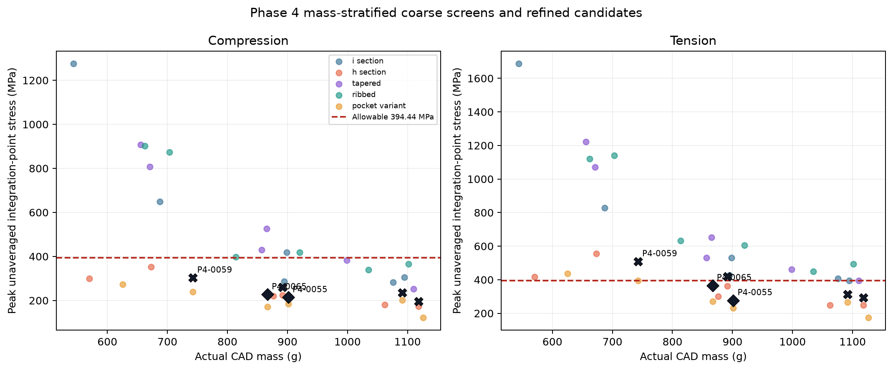

# Design-space exploration

## Sampling and CAD validity

Two reproducible five-family studies were completed:

| Study | Method / seed | CAD attempts | Valid solids | Invalid CAD | Valid per family |
|---|---|---:|---:|---:|---:|
| Initial bounded study | Seeded random, 20261110 | 64 | 60 | 4 | 12 |
| LHS study | SciPy family-wise Latin hypercube, 20261111 | 69 | 60 | 9 | 12 |

Across both studies: 133 attempts, 120 valid designs, 13 invalid/duplicate records, and 24 valid designs per family. Invalid CAD and fillet attempts remain in the raw manifests. Each valid design was exported and measured from its actual FreeCAD solid.

## FEA stages

Each study selected three candidates per family across actual CAD mass (low, middle and high): 15 paired candidates per study, 30 total. Each candidate received 6 mm compression and tension analyses, producing 60 coarse load-case results. These are screening results only.

Six mass/stress-promising candidates were subsequently refined. Five have local 1.25/0.75 mm paired load cases; P4-0065 also has a 0.5 mm level. The final two successive peak-stress changes for P4-0065 are 3.53% compression and 4.84% tension. Two candidates, P4-0055 and P4-0065, satisfy the project stress/displacement/buckling checks and the provisional successive peak-stress trend. P4-0065 is lighter and is the selected result within this finite tested set.

The 742.656 g P4-0059 design is the lightest refined design tested, but its 0.75 mm tension peak is 508.818 MPa and fails. P4-0026 is also lighter than P4-0055 but reaches 419.307 MPa tension at 0.75 mm. Finite sampling does not prove global infeasibility or a global optimum.

## Constraints and margins

The governing values are fixed at 28 kN compression, 18 kN tension, allowable 394.444 MPa, maximum displacement 0.35 mm and minimum linear buckling factor 1.8. Normalized margins use `(limit−response)/limit` for stress and displacement and `(factor−1.8)/1.8` for buckling. P4-0065 margins are 44.39% compression stress, 11.49% tension stress, 73.90% displacement and 299.79% linear-buckling factor.

The searchable design-level and solver-level records are in `data/phase4/phase4-evidence.json`, the two raw manifests under `runs/phase4-design-space*`, and `data/phase4/fea-dataset.jsonl`.
