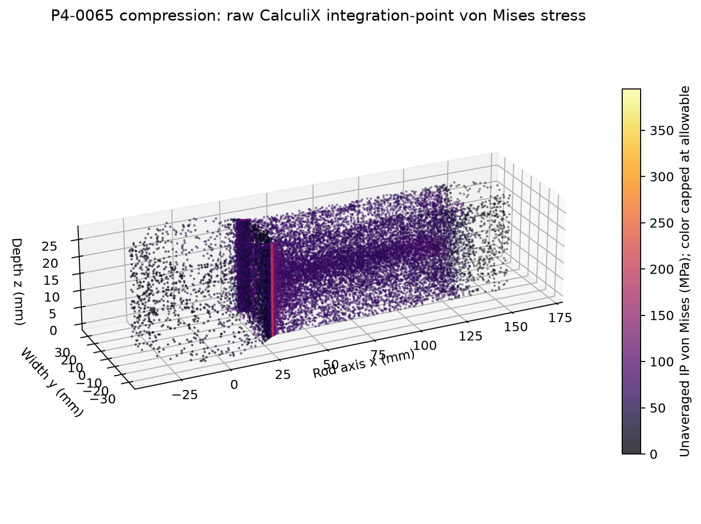
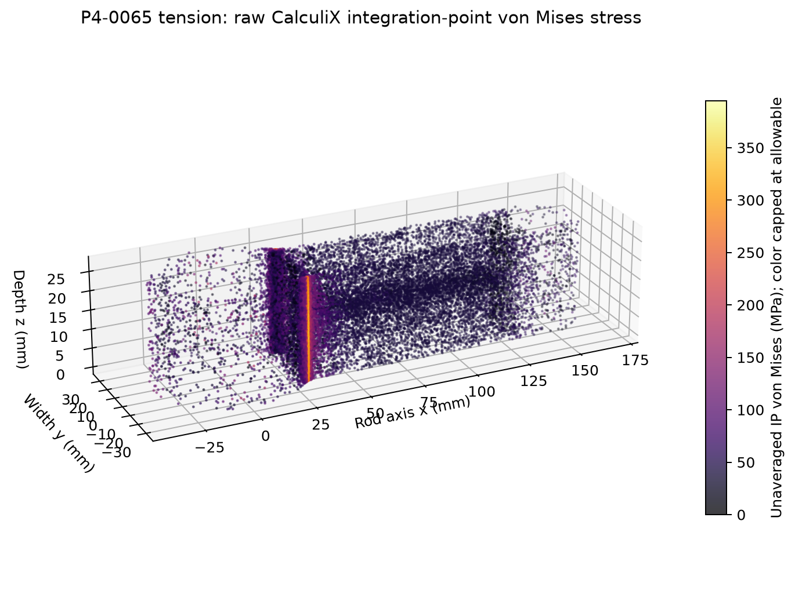
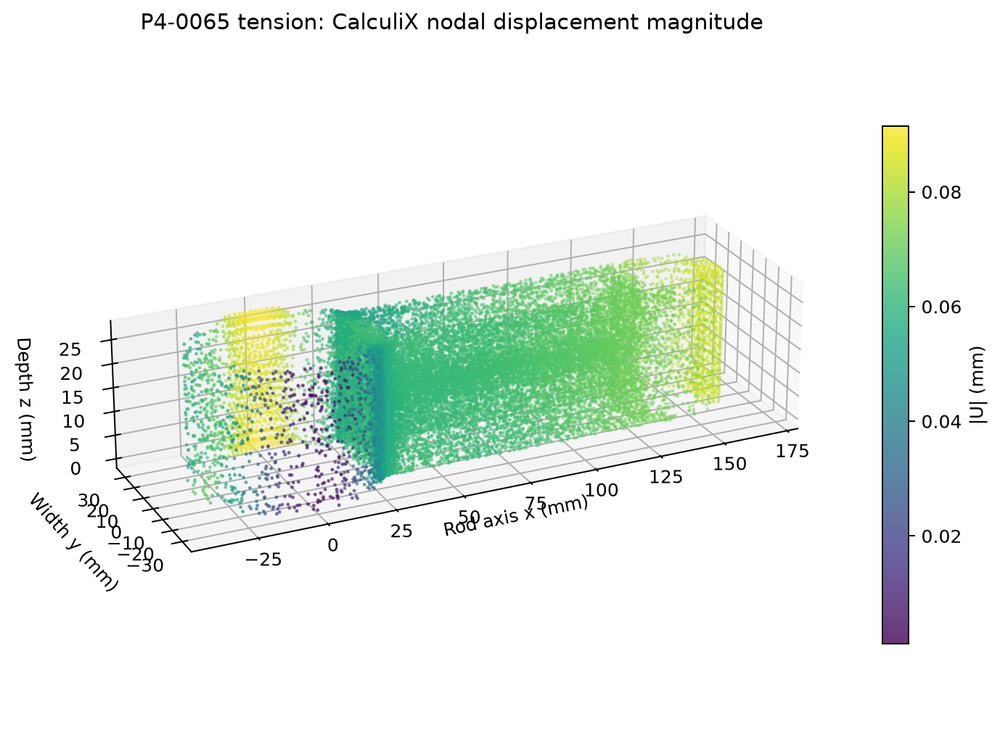

# Final candidate: P4-0065

## Geometry and mass

P4-0065 is a rounded-pocket H-section variant generated as a valid single FreeCAD solid. Actual CAD mass is 866.859782 g at the project density. The geometry has 145 mm center distance, 50 mm big-end bore, 24 mm small-end bore, ring thickness 9.151 mm, shank width 35.584 mm, section depth 26.970 mm, flange 6.677 mm, web 3.862 mm, transition radius 1.317 mm, pocket length 38.922 mm and pocket width 11.421 mm. STEP, BREP, STL and FCStd exports are retained in the run evidence.

## Static results

| Local target | Compression peak / U max | Tension peak / U max | Nodes / elements |
|---:|---:|---:|---:|
| 1.25 mm | 205.058 MPa / 0.058899 mm | 316.700 MPa / 0.091303 mm | 89,219 / 52,896 |
| 0.75 mm | 219.349 MPa / 0.058915 mm | 349.111 MPa / 0.091351 mm | 101,108 / 61,036 |
| 0.50 mm | 227.086 MPa / 0.058942 mm | 366.006 MPa / 0.091412 mm | 131,286 / 82,171 |

The 0.5 mm stress FoS values are 3.126 compression and 1.940 tension on the 710 MPa yield assumption. Both stress values are below 394.444 MPa and both displacements are below 0.35 mm.

## Hotspot field

The maximum lies at big-end/shank transition, element 98266, integration point 2, coordinates (29.3396, 17.8452, 13.5765) mm. The saved tensor order is xx, yy, zz, xy, xz, yz:

- Compression tensor: (−221.370, −45.907, −64.130, 88.780, 0.175, −0.392) MPa; principal values (−258.453, −64.131, −8.822) MPa; von Mises 227.086 MPa.
- Tension tensor: (349.261, 77.192, 97.814, −147.335, −0.282, 0.594) MPa; principal values (12.692, 97.816, 413.759) MPa; von Mises 366.006 MPa.

The yield check uses von Mises stress. The maximum principal tension is recorded as a separate field and is not substituted for the specified ductile-yield criterion. No smoothing or nodal stress averaging is used for acceptance.

## Stability and equilibrium

CalculiX linear eigenvalue buckling on the 0.5 mm compression mesh gives the lowest positive factor 7.196246 for the proportional 28 kN COSINE_BEARING load pattern, equivalent to 201.5 kN in this linear model. It exceeds the required 1.8 factor. This is a linear bifurcation result; it does not model imperfections, nonlinear postbuckling, plastic collapse or contact changes.

Forces balance within the solver reaction check (fraction 4.20e−13 in tension); the maximum recorded moment residual is about 3.35e−6 N·mm. Pressure-resultant equilibrium validates the implementation of the prescribed loads, not their equivalence to real pin contact.

## Mesh and qualification

The 0.75→0.50 mm peak-stress changes are 3.53% compression and 4.84% tension. Displacement changes are below 0.07%. The meshes are nonnested; no GCI or continuum error bound is available. P4-0065 passes the stated numerical constraints and the provisional last-pair mesh-trend target. It remains a research design requiring material certification, contact validation, fatigue assessment and manufacturing review before application.
