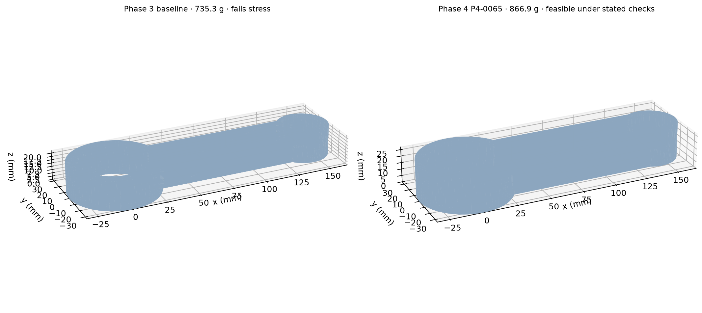

# Feasibility-first lightweight selection

## Search rule

The search ranks actual CAD mass only after checking structural constraints. Two reproducible family studies generated 120 valid CAD designs; 30 mass-stratified geometries then received paired 6 mm compression/tension screens. Six promising candidates were refined. No model prediction was treated as FEA. Differential evolution, SLSQP and Bayesian optimization were not used because the high-fidelity set is too small for an evidence-backed global optimizer or surrogate constraint model.

## Feasible reference and selected design

P4-0055 is the Phase 4 reference at 901.429 g. After the separate Latin-hypercube study, P4-0065 was selected at 866.860 g after the recorded stress, displacement, buckling and last-pair mesh-trend checks. P4-0055 was additionally run at the same 0.50 mm local target with equivalent bulk mesh, element order, boundary model, transition refinement and solver workflow. These are distinct geometries and separately generated meshes; no identical discretization is implied. The reduction is 34.569 g (3.835%) relative to P4-0055.

The Phase 3 baseline is 735.327 g, but it fails both stress constraints. P4-0065 is 131.533 g (17.888%) heavier than that unsafe baseline. This is reported directly and is not described as a weight reduction. The Phase 4 result demonstrates a lighter candidate relative to a feasible Phase 4 reference, not a lighter rod than the original unsafe baseline.

The final design is the lowest-mass candidate passing the recorded stress/displacement screen and project last-pair mesh-trend target among the six refined designs, not a global mass optimum. Two other candidates fail the recorded stress screen; two meet that screen but fail the mesh-trend check; one also lacks a recorded buckling result. Independent solver verification is `NOT_PERFORMED`; mechanical qualification and optimization eligibility are `NOT_QUALIFIED`. No claim is made about untested points in the 120-design CAD space.

