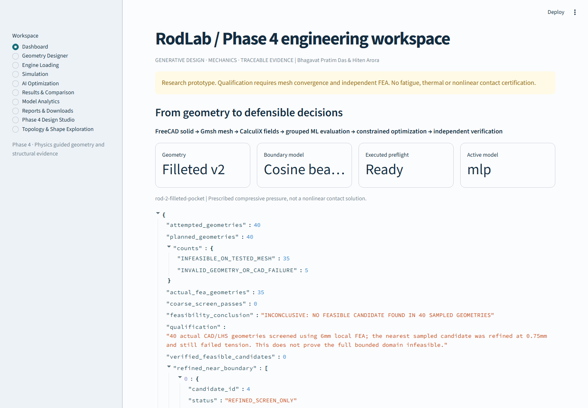

# Phase 4 Final Project Report

## Executive result

Phase 4 implemented physics-guided parametric geometry exploration, recorded CAD/FEA screening, refined candidate analysis, engineering reporting, and a responsive Streamlit interface. This report does **not** certify a production connecting rod or claim a globally optimal feasible design. P4-0065 is the lowest-mass of six refined candidates that passes the project's recorded numerical screens; its solver and material assumptions still require independent engineering validation.

## Dashboard correction

The dashboard's raw JSON leak was caused by three `st.json(...)` calls in the former `Dashboard` branch of `app.py`: the Phase 3 feasibility summary, mesh-convergence record, and search counts. The feasibility summary was the visible `attempted_geometries` object. The current renderer is `src/conrod/ui/views/dashboard.py::render_dashboard`; it presents stored data through project-status metrics, exploration counts, structural-check metrics, mass comparisons, and charts. Dashboard source records remain downloadable in the collapsed **Advanced diagnostics — Developer only** panel. Other raw JSON renderers are confined to collapsed developer diagnostics.

The page audit covered Dashboard, Geometry Designer, Engine Loading, Simulation (including boundary-condition controls), AI Optimization, Results & Comparison (structural analysis), Model Analytics, Reports & Downloads, Phase 4 Design Studio, and Topology & Shape Exploration. The only `st.json` renderer is in the collapsed diagnostics helper. Streamlit exceptions and solver logs are not rendered as normal engineering results.

## Recorded design-space and structural results

- 133 geometry attempts produced 120 valid CAD candidates and 13 invalid or duplicate candidates across five geometry families.
- 30 candidates received paired coarse compression/tension FEA. Those coarse results are screens, not feasibility declarations.
- The dataset contains 86 load-case records, grouped into 30 distinct geometry hashes; mesh levels and load cases are not independent statistical samples.
- Six candidates received refined FEA. P4-0065 has an actual CAD mass of 866.860 g. Its 0.50 mm local-target mesh recorded 227.086 MPa compression stress, 366.006 MPa tension stress, and 0.091412 mm maximum displacement.
- On the historical 710 MPa yield assumption, the corresponding tension yield factor is 1.940. The lowest positive linear eigenvalue buckling factor is 7.196 for the prescribed 28 kN compression pattern.
- Successive 0.75-to-0.50 mm peak-stress changes are 3.53% compression and 4.84% tension. The meshes are nonnested, so this is not a GCI or continuum-error bound.
- P4-0065 is 3.835% lighter than P4-0055 (901.429 g), a recorded Phase 4 comparison. It is 17.888% heavier than the 735.327 g Phase 3 baseline, which fails the project's stress limits. No weight reduction from the Phase 3 baseline is claimed.

These values are project solver records, not physical test results or an independent solver-to-solver verification. The engineering interpretation and candidate limitations are detailed in [Final Design Validation](FINAL_DESIGN_VALIDATION.md), [Final Optimization](FINAL_OPTIMIZATION.md), and [Limitations](LIMITATIONS.md).

## Browser QA and screenshots

Headless Playwright 1.65.0 with Microsoft Edge/Chromium 157 inspects ten application pages at 390 × 844, 768 × 1024, 1024 × 768, 1440 × 1000 and 1920 × 1080 viewports (50 route/viewport cases). The audit checks navigation and controls, visible JSON renderers, mobile sidebar closure, horizontal overflow and clipping, Streamlit exceptions, browser console/page errors, HTTP failures and failed requests. The exact final counts are recorded in `outputs/phase4-visual-qa/browser-qa-report.json`; the browser report and page screenshots are in `outputs/phase4-visual-qa/` and the final evidence archive.

## Reproduction and test status

The final source revision, test reports, raw CalculiX `.frd`/`.dat` fields, input decks, CAD exports, meshes, stress/displacement fields, engine calculations, ML artifacts, and visual-QA evidence are listed and SHA-256 verified in `outputs/phase4-final-solver-evidence-final.zip`'s manifest. This final archive is distributed as five independent ZIP parts, each below 512,000,000 bytes. The preserved historical intake archive remains at `outputs/phase4-final-solver-evidence.zip`. The complete source/UI review package is `outputs/phase4-complete-review-bundle/rodLab-phase4-complete-source.zip`. See [Test Results](TEST_RESULTS.md) for the full-suite, CAD/FEA integration, Ruff, compile, and browser-QA outcomes.

## Engineering limitations

- Material yield strength remains an assumption; no heat-treatment certificate or coupon tests were supplied.
- Loads are prescribed reference forces. Engine calculations do not substitute for measured cylinder-pressure data.
- COSINE_BEARING applies an equivalent pressure; nonlinear pin contact, friction and clearance are unvalidated.
- No GCI/continuum error bound, fatigue-life calculation, nonlinear postbuckling, manufacturing qualification, or independent solver verification is available.
- The exploration is finite and parametric, not density-based SIMP topology optimization. ML outputs do not enforce constraints.
- Consequently, no production suitability, fatigue life, global optimum, or independently validated feasible component is claimed.
