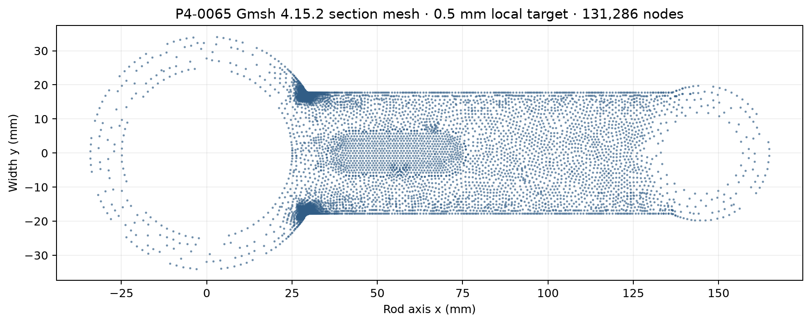
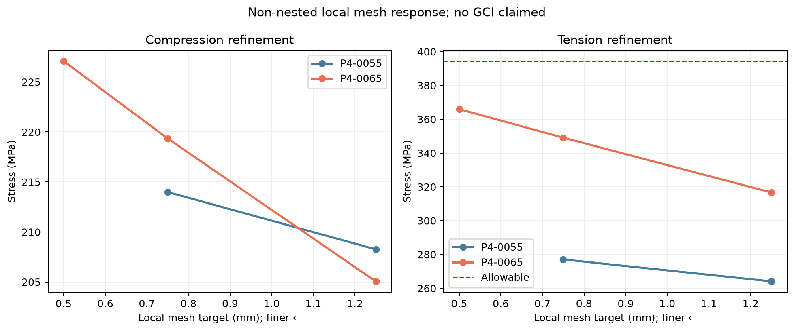

# Mesh and structural validation

## Final geometry and mesh sequence

P4-0065 was generated as a valid FreeCAD solid and meshed with deterministic Gmsh 4.15.2 settings (seed 42, one meshing thread, second-order quadratic tetrahedra, C3D10 in CalculiX). A 4 mm bulk target and full-thickness big-end-transition local refinement were used at local targets 1.25, 0.75 and 0.5 mm. The tension solve reused the compression mesh within each fidelity level. Meshes at different levels were independently generated and are nonnested.

| Local target (mm) | Nodes | Elements | Peak compression (MPa) | Peak tension (MPa) | U max, C/T (mm) | minSICN min / 1st percentile |
|---:|---:|---:|---:|---:|---:|---:|
| 1.25 | 89,219 | 52,896 | 205.058 | 316.700 | 0.058899 / 0.091303 | 0.0663 / 0.3601 |
| 0.75 | 101,108 | 61,036 | 219.349 | 349.111 | 0.058915 / 0.091351 | 0.0527 / 0.3620 |
| 0.50 | 131,286 | 82,171 | 227.086 | 366.006 | 0.058942 / 0.091412 | 0.0304 / 0.3641 |

The final successive peak-stress changes from 0.75 to 0.50 mm are 3.53% compression and 4.84% tension, below the provisional 5% target. Displacement changes are below 0.07% over that pair. The earlier 1.25→0.75 mm stress changes are larger (6.97% compression, 10.23% tension), showing a continuing upward trend before the last pair.

## Qualification boundary

The <5% result is a provisional successive-mesh trend, not a continuum error bound. Meshes are nonnested; no GCI/Richardson estimate is claimed. The finite-radius hotspot remains localized at the big-end/shank transition. The maximum unaveraged integration-point von Mises value is used without nodal smoothing or averaging for acceptance. The minimum SICN quality falls to 0.0304, while the first percentile remains about 0.364; no per-element quality value is substituted for stress acceptance.

The final raw field is 227.086 MPa compression and 366.006 MPa tension at the same element/IP in the 0.5 mm mesh. At the controlling integration point, the tension tensor in the saved order xx, yy, zz, xy, xz, yz is (349.261, 77.192, 97.814, −147.335, −0.282, 0.594) MPa; the compression tensor is (−221.370, −45.907, −64.130, 88.780, 0.175, −0.392) MPa. The raw field JSON is authoritative.

