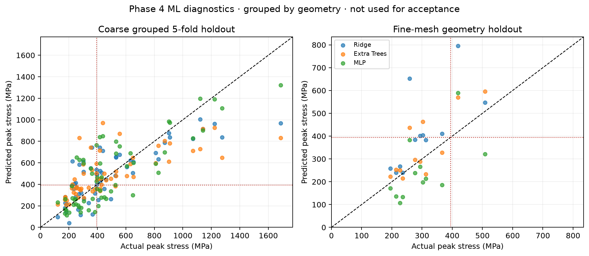

# Phase 4 grouped machine-learning evaluation

## Dataset and leakage controls

`data/phase4/fea-dataset.jsonl` contains 86 stored load-case records: 60 coarse records from 30 geometry groups and 26 refined records across six geometries. Five-fold coarse evaluation groups on canonical `geometry_hash`; fold audits assert disjoint hashes. The six fine-holdout hashes are held out from coarse training. The checked-in evaluation stores 216 genuine row-level predictions: 180 coarse out-of-fold predictions (three models × 60 rows) and 36 fine-holdout predictions (three models × 12 rows).

The predictions include model, candidate ID, geometry hash, load case, fidelity, actual FEA stress, predicted stress, residual and fold ID for the coarse folds. Fine-holdout rows have no fold ID because they are a separate geometry holdout. Dataset rows across load cases and mesh levels are repeated records, not independent geometries.

## Coarse grouped 5-fold out-of-fold results

| Model | Rows | MAE (MPa) | RMSE (MPa) | R² |
|---|---:|---:|---:|---:|
| Ridge | 60 | 143.320 | 192.046 | 0.643 |
| Extra Trees | 60 | 155.782 | 228.666 | 0.493 |
| MLP | 60 | 151.829 | 190.869 | 0.647 |

## Coarse-trained, fine-geometry holdout

| Model | Rows | MAE (MPa) | RMSE (MPa) | R² |
|---|---:|---:|---:|---:|
| Ridge | 12 | 114.353 | 169.281 | −2.720 |
| Extra Trees | 12 | 69.017 | 90.725 | −0.068 |
| MLP | 12 | 104.670 | 117.872 | −0.804 |

This holdout has only six independent geometry groups and also changes mesh fidelity. Its error therefore reflects geometry extrapolation together with a fidelity shift; it is not a large external validation set. The MLP reached its 1,500-iteration limit without convergence. Historical Phase 3/Phase 2 scores are separate and are not relabeled as Phase 4 predictions.

## Use boundary

The best fine-holdout MAE (Extra Trees, 69.017 MPa) is greater than P4-0065's 28.4386 MPa tension headroom to the 394.444 MPa allowable. All models remain exploratory. They do not enforce stress, displacement, buckling or optimization constraints, and they do not replace CalculiX results.
