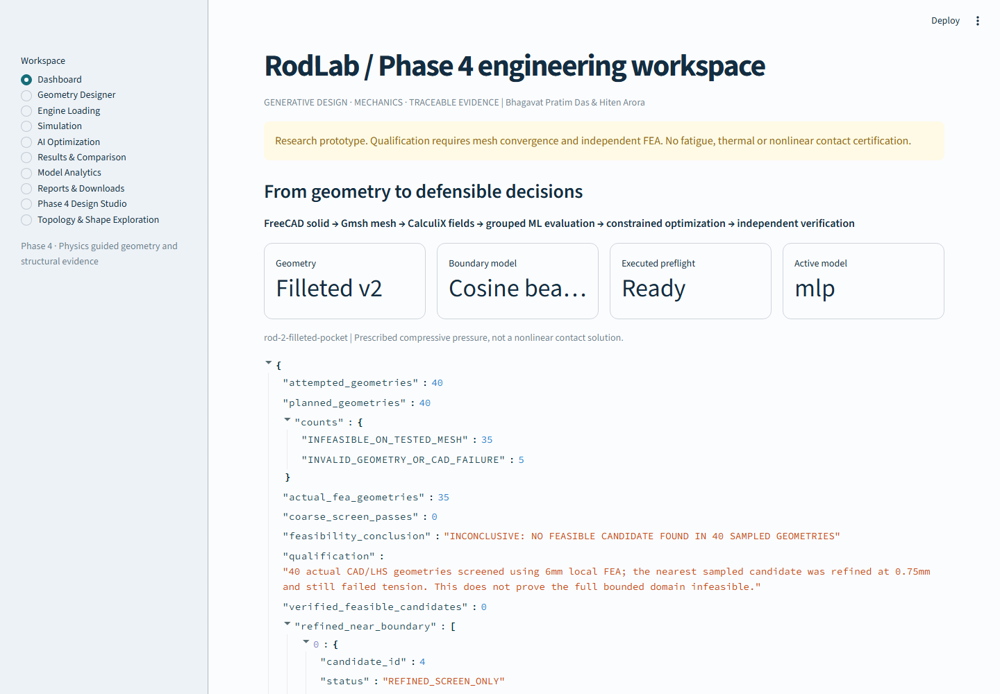
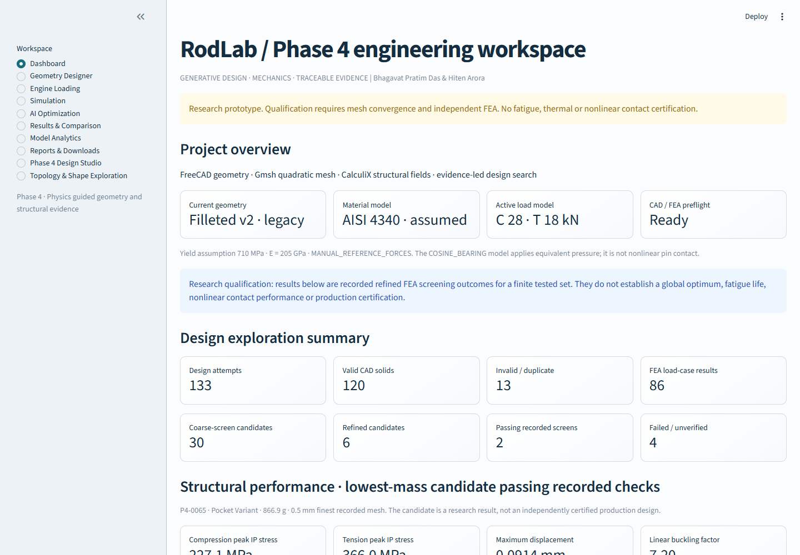
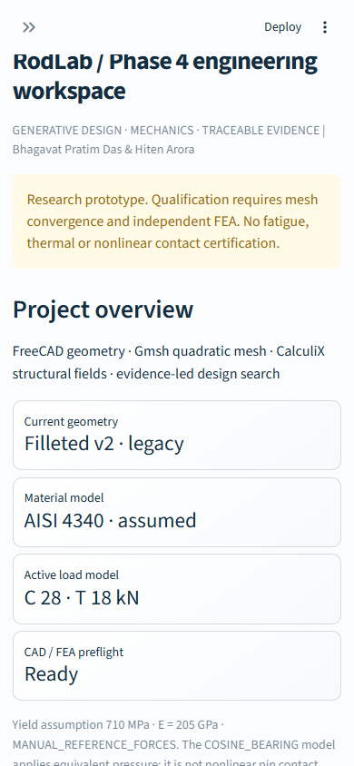
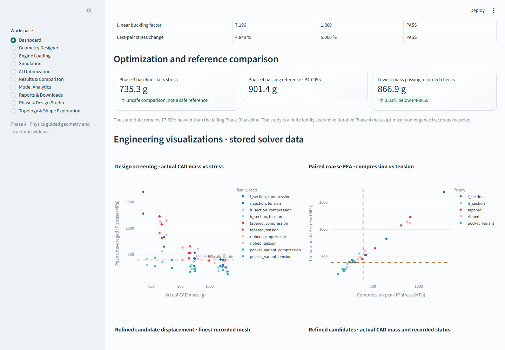

# Phase 4 Website QA

## Dashboard raw-data regression

The dashboard leak came from three direct renders in the `Dashboard` branch of `app.py`: `st.json(read(data))` for the Phase 3 feasibility summary, `st.json(read(conv))` for the mesh-convergence record, and `st.json(study.get("counts", {}))` for the Phase 3 search counts. The first call produced the visible `attempted_geometries` object reported by the user.

The dashboard now presents project, design-space, structural and mass-comparison values as metrics, tables and plots driven by the stored Phase 3/Phase 4 records. Raw diagnostic records remain downloadable inside the collapsed **Advanced diagnostics — Developer only** section. Other pages use readable tables and engineering plots; the sole `st.json` call is inside the same collapsed diagnostics helper.

The page audit also found a nested background-job result table on Results & Comparison and a legacy optimizer table that exposed raw solver messages. Both now show curated engineering columns; the full records remain available in the collapsed developer diagnostics. Historical Phase 2 model-evaluation metadata on Model Analytics is presented as holdout metrics and a response-by-statistic comparison table, while its source record remains available in developer diagnostics.

## Browser method and results

- Application: `http://localhost:8505` (HTTP 200; Streamlit health endpoint returned `ok`).
- Browser: Playwright 1.65.0 with installed Google Chrome 157.0.8103.40, headless.
- Desktop viewport: 1440 × 1000 px.
- Mobile viewport: 390 × 844 px.
- All 10 workspace pages were opened at both viewports: Dashboard, Geometry Designer, Engine Loading, Simulation, AI Optimization, Results & Comparison, Model Analytics, Reports & Downloads, Phase 4 Design Studio, and Topology & Shape Exploration.
- Geometry-family selection was changed to Tapered I section and verified without submitting CAD/FEA. Simulation and optimization controls rendered; no additional costly solve was launched by browser QA.
- No visible raw JSON components or dashboard feasibility keys were found on normal views. No horizontal overflow was measured at either tested width. No JavaScript console errors, uncaught page errors, failed requests, HTTP errors, or Streamlit exceptions were observed.
- Browser QA validates rendered navigation and controls; it does not replace the recorded CAD/FEA integration suite or establish a production-qualified component.

## Screenshots

The before image shows the raw summary JSON. The after images show the dashboard at desktop/mobile sizes and the stored solver-data visualization section.

The machine-readable browser report and all page screenshots are stored under `outputs/phase4-visual-qa/`.
